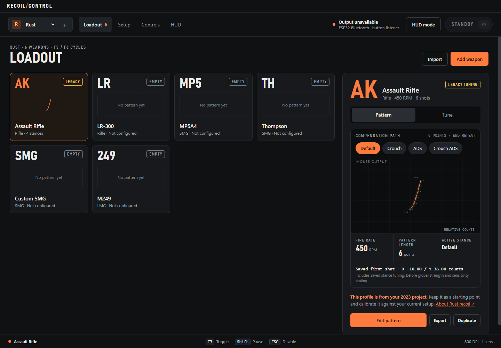

# Recoil Control

A Windows desktop app for authoring, previewing, and tuning per-weapon mouse
profiles, with a compact always-on-top HUD and an ESP32 Bluetooth mouse relay.



*The app with default profiles and ESP32 Bluetooth selected, before connecting hardware.*

## What it does

- **Loadout:** game collections, weapon cards, stance-specific patterns, and JSON import/export.
- **Pattern workshop:** draggable shot positions, a shot timeline, range adjustments,
  generators, guide conversion, and recording your own mouse pulls.
- **Game-specific stances:** optional Prone and named custom postures, separate ADS
  patterns, and per-game hold or toggle bindings. Rust keeps its existing stances.
- **Live tuning:** arrow-key adjustments for a single stance, with a lockable target
  so you can release ADS/crouch while editing.
- **Controls and HUD:** per-game shortcuts, direct weapon bindings, quick weapon
  switching, and a draggable, lockable status overlay.
- **Hardware:** mouse passthrough independent of the app, animated status LEDs,
  connection diagnostics, and an in-app firmware updater with restart recovery.

The tested hardware path is **Razer Cobra Pro (Bluetooth) → Seeed XIAO ESP32-C3 →
Windows (Bluetooth)**. USB powers the board and carries app commands and telemetry.
Physical movement, clicks, and scrolling continue when the app closes; profile
output stops. The relay and keyboard shortcuts **do not require Interception**.

## Get started

Use **Node.js 24 or newer**. Live input requires **x64 Windows**; Linux can run
the app's UI, pattern editor, and simulated-input tests without hardware.
Run from the repository root:

```powershell
git clone https://github.com/Lizard-King101/RecoilControl.git
cd RecoilControl
npm ci
npm start
```

The legacy Windows-only `node-interception` addon is optional and is skipped
automatically on Linux. Normal `npm install` and `npm ci` need no platform overrides.

The UI and pattern editor work without hardware. To use the relay:

1. Follow the [firmware setup and pairing guide](firmware/README.md) for the first
   upload and Bluetooth pairing. PlatformIO is needed to build or upload firmware
   from source; the desktop updater uses the bundled release.
2. In **Settings → Board & Bluetooth**, select **ESP32 Bluetooth** if the app
   still has the legacy driver selected. Enter your actual DPI, game sensitivity,
   and ADS multiplier under **Settings → Mouse & sensitivity**. DPI measurement
   through the old driver is unavailable in relay mode.
3. Connect USB under **Settings → Board & Bluetooth**. A single connected board is
   picked up automatically; with multiple boards, choose its port. Wait for both
   the Windows and Cobra links to connect.
4. Select a configured weapon, switch away from the configuration window, and
   press **F7** to enable. Press **Escape** to disable.

The app always starts in standby. Configuration focus and an interactive HUD pause
compensation. After enabling, pausing, or switching weapons, release fire before
starting a new burst. Saving settings returns to standby. HUD and shortcut weapon
switches keep the enabled state when the destination has a pattern.

## Profiles and tuning

The default Rust collection contains Assault Rifle, LR-300, MP5A4, Thompson,
Custom SMG, and M249. **Only Assault Rifle ships with movement data**, marked
**Legacy tuning**. Other slots are ready for your own patterns; no current verified
Rust recoil dataset is bundled.

Open **Loadout → Edit pattern** to author shots, or **Loadout → Tune** for live
stance adjustments and calibration. **Save tuning** applies the draft to the
stored pattern and starts the next tuning session at 100% of those saved values.
Closing the app discards unsaved tuning.

Weapons now support **Attachment setups**: keep Base, copy it into a named setup,
and describe any attachment slots your game uses. Each setup has its own shots,
stances, strength, and calibration. Switch in Loadout or the unlocked HUD; export
shares the whole weapon and all setups in one file. Attachment effects are authored
under Tune or Edit pattern rather than assumed from attachment names.

The **Vision lab** prototype supports masked screen/clip tracking, small per-shot
correction proposals, and Linux desktop pointer output without a BLE board. It uses
a countdown to arm, then mouse hold/release for existing games. A simulator link
is optional for synchronized tests. See the
[Linux recording lab guide](docs/vision-lab.md) for the client helper,
calibration, and current limits.

See the [profile authoring and tuning guide](docs/profiles.md) for recording pulls,
editing vectors, stance locks, tuning limits, and importing a recoil guide.
Previews show the app's mouse output, not measured game recoil. Fixed patterns
need testing against your setup and cannot correct every variation between bursts.

## Navigation and binding controls

Select a game in the left sidebar, or use **Add game** to create a collection.
**Loadout** and **Controls** sit together in the top bar. The **Settings** menu
contains separate **Mouse & sensitivity**, **Board & Bluetooth**, and **HUD** pages.
Mouse sensitivity remains per game; board connection and HUD preferences are shared.

In Controls, click a binding and press the desired key, keyboard combination,
middle mouse button, or side button (Mouse 4 / Mouse 5). Escape cancels recording;
the × clears optional weapon and stance bindings. Save controls to apply changes.
Left and right mouse remain reserved for fire and ADS. Pause and stance bindings
use a single key or mouse button; action and weapon shortcuts also accept modifiers.

For compensation, choose **Toggle on / off** or **Hold to enable**. For example,
record Mouse 4 and select Hold to enable. Releasing the binding stops compensation,
including during a weapon switch. You can use crouch and other stance keys while
holding it. Configuration focus and Escape cancel a hold;
press it again after returning to the game. If fire was already held when enabling,
release fire before starting a new burst. In hold mode, the UI/HUD cannot latch
compensation on. The default remains F7 with toggle behavior.

## Default controls

| Control | Action |
| --- | --- |
| F7 | Toggle compensation |
| F5 / F6 | Previous / next configured weapon |
| Escape | Disable immediately |
| F8 | Toggle live tuning without enabling compensation |
| F9 while tuning | Cycle the editing target through stances, then follow the current stance |
| Left / Right while tuning | Decrease / increase horizontal strength |
| Down / Up while tuning | Decrease / increase vertical strength |
| Hold Shift | Pause compensation |
| Left / right mouse | Fire / ADS |
| Hold Ctrl | Crouch stance |
| Ctrl+Shift+H | Restore the main window from HUD mode |

**Controls** stores action keys, pause and stance keys, and direct weapon shortcuts per
game. Add Prone or a custom stance there, choose Hold or Toggle, then use
**Edit pattern → + Stances** to copy a starting pattern and tune it. Stance keys
are independent of ADS; only one posture is active at a time. Escape clears toggled
stances. Match the game's controls: the app does not detect in-game posture.
Shortcuts also reach the foreground application; modifier combinations must
match exactly. Escape and Ctrl+Shift+H are fixed.

The **HUD** settings control visibility, opacity, position, and locking. Unlocked,
it offers weapon selection and On/Off buttons; locked, clicks pass through. Use
borderless/windowed mode if an exclusive fullscreen game hides desktop overlays.
Closing the HUD hides it; closing the configuration window exits the app.

## Firmware updates and recovery

Bundled firmware **0.7.0** supports the relay, profile output, pull recording, and
WS2812B status LEDs on **D7 / GPIO20**. The default strip has 24 LEDs; brightness
and LED count are saved on the board, with an estimated 350 mA LED power budget.
See the [hardware guide](firmware/README.md#hardware-and-power) for wiring and limits.

Under **Settings → Board & Bluetooth → Firmware**, press **Update** or **Reinstall**
twice to confirm. Keep USB connected and a keyboard or spare mouse available:
passthrough pauses during flashing and restart. Normal app exit is blocked during
the operation.

The updater verifies the bundled checksums, writes and verifies the application
and boot selector, then resets the board and releases the serial port. It preserves
Bluetooth pairings and LED settings. Completion requires the expected running
firmware, passed relay startup checks, fresh telemetry, and stable paired mouse
links. New unpaired boards receive pairing instructions instead.

Recovery follows the board's USB identity if Windows changes its COM port. It
tries at most two additional resets if firmware does not answer; once firmware
answers, it waits for Bluetooth without restarting it again. Allow about 30 seconds
after writing for reconnection.

If recovery times out, choose **Retry board recovery**, or press **Alt+R** with the
main window focused. This retries without reflashing. You can also press the
board's **RESET** button without holding **BOOT**, or reconnect USB. An interrupted
write may require another update or `npm run firmware:upload`; there is no
automatic image rollback.

The in-app 0.7.0 reinstall and restart were confirmed working on the local relay
on **2026-11-02**. This is a successful hardware test, not a guarantee for every
USB or Bluetooth setup.

## Settings

Settings live at `%APPDATA%\Recoil Control\settings.json`. Saves use a temporary
file and keep the previous version as `settings.json.backup`. Invalid settings
are preserved for recovery. Game collections, patterns, bindings, calibration,
and HUD preferences are local; enabled state never persists across launches.

## Development

| Command | Purpose |
| --- | --- |
| `npm start` | Build and launch the desktop app |
| `npm run build` / `npm run typecheck` | Compile / check TypeScript |
| `npm test` | Run simulated-input and protocol regression tests |
| `npm run test:desktop` | Run isolated renderer, IPC, persistence, and HUD checks |
| `npm run test:navigation-desktop` | Test sidebar/settings navigation, binding recording, cancellation, and persistence without hardware |
| `npm run test:stances-desktop` | Test stance authoring, previews, persistence, and sharing without hardware, including on Linux |
| `npm run screenshots` | Regenerate documentation screenshots with isolated defaults |
| `npm run demo` | Print simulated bursts without native input or hooks |
| `npm run firmware:build` | Build firmware and package the bundled release with checksums |
| `npm run firmware:upload -- --upload-port COM3` | Upload with PlatformIO; substitute your port |

Automated desktop checks use temporary settings, keep compensation disabled,
disable hardware auto-connect, and refuse firmware writes. They do not establish
game compatibility or measure end-to-end mouse latency. Hardware checks and
protocol details are documented in [firmware/README.md](firmware/README.md).
The full `test:desktop` suite still expects Windows input initialization; the
stance-specific desktop suite works without that backend.

The TypeScript input engine is in `src/`; Electron windows, persistence, the worker,
and firmware updates are in `src/desktop/`. Sandboxed renderers live in `ui/`.
Native input runs outside the renderers; IPC validates senders and submitted data.
Firmware sources and pinned PlatformIO dependencies live in `firmware/`.

### Legacy driver and CLI

The original Interception backend and CLI remain available separately:

```powershell
npm run doctor
npm run cli -- --help
npm run cli -- --trace
```

`doctor` checks the legacy native addons and driver-visible mice. A failure does
not diagnose the ESP32 relay. The CLI uses **Enter + Numpad Plus**, rather than the
desktop's F7 default. Trace mode reports aggregate input/output counters and pause
state; an accepted driver packet does not prove an application consumed it.

Interception requires a separate administrator installation and Windows restart;
`npm ci` and the app never install or remove it. See the
[upstream driver instructions](https://github.com/Rami-Sabbagh/node-interception#installation)
if you specifically need that backend. Its Rust compatibility remains unresolved.
The optional dependency is pinned; the app's input types and adapter interface
compile independently of its declarations.

### Community library

Open **Community** to publish a game pack locally, browse and preview weapons, attachment variants and stances, or add a shared pack file. Installing adds a separate game collection and preserves existing loadouts. Export packs to share them. The local service starts automatically; nothing is published online. See [the community library guide and hosting plan](docs/community-library.md) for usage, the standalone development service, and Linode/Cloudflare options.
