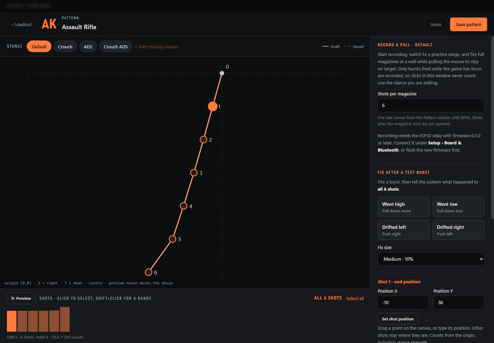

# Profile authoring and tuning

Return to the [project README](../README.md) for setup and default shortcuts.

## Live stance tuning

Set your DPI, game sensitivity, and ADS multiplier under **Setup → Mouse &
sensitivity** first. In **Loadout → Tune**, **Output strength** scales all stances;
**Apply strength** saves those global values. **Save calibration** records the
setup you tested while preserving the current output. Calibrated profiles scale
inversely with changes to game sensitivity and ADS multiplier; verify that
adjustment in-game. DPI does not directly multiply raw output counts.

Open **Loadout → Tune → Live stance tuning**, or press **F8** away from the
configuration window. By default, arrow keys follow your current ADS/crouch stance.
Choose **Tuning target → Lock: Crouch ADS** (or another stance) to edit it after
releasing the mouse and Ctrl. While tuning, **F9** cycles through the available
stances and back to **Follow current stance**. The lock selects which values the
arrows edit; compensation continues to use your actual ADS/crouch buttons. The HUD
names the editing target and shows **LOCKED** or **FOLLOW** separately from the
actual output stance. Save, discard, or changing profiles resets the target to
following. F8/Escape keep the target for the next tuning burst in the same session.

The default step is one percentage point of the saved strength;
the panel also offers 2% and 5%. Holding an arrow does not repeat adjustments.
The HUD shows the current stance, horizontal/vertical percentages, and step.
Arrow keys are observed, so they also reach the foreground application.

Changes stay in memory until **Save tuning**. F8 stops editing while retaining the
applied draft. Escape stops editing and disables compensation. **Discard** restores
saved strengths and disables compensation. Save also disables compensation; enable
it again when ready. Saving applies every edited stance to its stored pattern and
starts a new draft at 100% of those saved values. The Tune panel and weapon
preview show saved first-shot counts, before global strength and sensitivity scaling.
For counts patterns, saving folds the gain into the shot vectors and normally resets
their extra multipliers to 1 × 1. A new session can increase the saved result again;
the stored multiplier's old 2× ceiling no longer strands tuning at 100% after saving.
Each session allows up to 300% of the saved strength, subject to the pattern's actual
per-shot storage bounds. The Tune panel shows each axis's session maximum, and the HUD
marks a reached limit. Saving does not bypass the actual per-shot bound.
Save/discard before switching weapons, editing patterns, or
reconnecting. Closing the app discards the draft. The physical ESP32 mouse relay
does not depend on tuning or the app staying connected.

## Pattern workshop

**Loadout → Edit pattern** opens the full-window pattern workbench. Stance chips
switch the stance being edited. The canvas shows the draft's cumulative shot
endpoints with the last saved version dashed behind it. The shot timeline below
selects one shot (click) or a range (Shift+click); **Select all** resets it.

### Record a pull

**Record a pull** (relay firmware 0.5.0 or later) builds a stance from your own hand.
Set the shots per magazine, press **Start recording**, then fire full magazines in a
practice range while pulling the mouse to stay on target. The HUD shows **REC** and the
take count. Compensation stays off, and cannot be enabled, until recording stops;
leaving the workbench stops it too. Each take runs from a fire press to its release.
Takes with lost movement data, under 250 ms, or over 15 seconds are discarded with a
reason; the latest five are kept. Takes are split into shots at the pattern's fire
rate, and shots after the magazine runs dry are ignored. **Use recording** combines
the takes with a per-shot median and rates their consistency. Takes whose ADS state
does not match the stance are skipped (crouch cannot be detected from the mouse).
The result is divided by the weapon's strength and sensitivity/ADS calibration so
output reproduces the recorded movement, sets the stance multiplier to 1 × 1, and
records the current DPI/sensitivity as the calibration if none existed. Undo restores
the previous shots.

### Edit shots and convert guides

**Fix after a test burst** adjusts the selected range: **Went high / Went low** scale
its vertical pull up or down; **Drifted left / right** push X against the drift by a
share of the range's average shot size (at least 0.5 counts). Fix size is 5%, 10%, or
20%. With unsaved changes, Back or Escape asks before discarding.

Collapsible tools keep the earlier editing options: the shot table (add/duplicate/
remove shots, paste X/Y pairs), reshape a range by percentage, build from shot
positions, generate a constant pattern or a linear ramp, and copy a stance. Drag an endpoint or
select a shot and enter its X/Y position to reshape it; the other endpoints stay
fixed, so the two connecting vectors change. Position editing includes stance
multipliers and requires them to be nonzero. Range tools scale selected shot vectors
independently on X/Y; a negative scale mirrors an axis. These actions have undo.
The preview updates before saving and never sends mouse movement.

**Build from shot positions / a recoil guide** accepts one cumulative X/Y position
per shot in firing order, relative to an origin at (0, 0), with positive Y down.
Choose game recoil to invert both axes, or desired compensation to retain them.
An adjustable reference scale converts coordinates to counts. Conversion replaces
only the current stance and resets its extra multiplier to 1 × 1. Screen pixels
are not mouse counts; reference paths still require in-game tuning. This is manual
guide conversion, not automatic screen capture or game-recoil recording.

### Add weapons and save patterns

**Add weapon → Create & edit pattern** opens the workshop with a blank pattern or a
copy of a configured weapon. Blank patterns start with zero movement and a generic
600 RPM that you should replace. Copies keep tuning and calibration but clear the
direct shortcut. The weapon list also supports **Duplicate** for separate variants.
LR-300 and Custom SMG remain available as empty slots for authoring your own patterns.

New and edited patterns use raw **counts per shot**. RPM changes timing without
changing each shot's distance. Opening a legacy pattern converts its vectors and
stance multipliers to counts while preserving its integrated movement, within
integer rounding. The converted editor multipliers start at 1 × 1 because saved
stance strength is already included in the shot counts. Cancelling the editor
leaves the saved pattern untouched. Each shot keeps the existing velocity easing.
The workshop preview includes stance
strength, before global weapon strength and sensitivity scaling. Counts-format
exports use `recoil-control/weapon-v2`; imports accept both v1 and v2.

These tools help measure and tune local profiles; they do not supply verified
current Rust recoil patterns. The bundled AK values are a legacy starting point.
